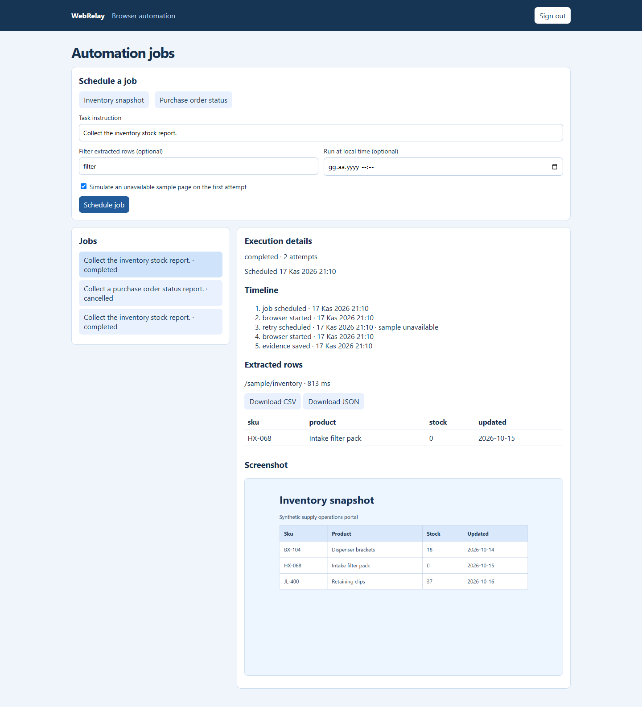

# WebRelay

WebRelay schedules browser reports against an authorized synthetic supply portal. The planner maps an inventory or purchase order instruction to a bounded template. Playwright collects rows in an isolated Chromium session, validates the fields and stores a screenshot and report.



## Run locally

Use Python 3.12.

```sh
python -m venv .venv
.venv/bin/python -m pip install -r requirements-dev.txt
.venv/bin/python -m playwright install chromium
DEMO_MODE=true .venv/bin/python -m uvicorn webrelay.app:from_env --factory --host 127.0.0.1
```

On PowerShell, use `.venv/Scripts/python.exe` and set `$env:DEMO_MODE = 'true'` before starting Uvicorn. On Linux, install browser system dependencies with `python -m playwright install --with-deps chromium`.

Open [http://127.0.0.1:8000](http://127.0.0.1:8000). Schedule the inventory template and select the simulated outage checkbox. The first browser visit receives HTTP 503. The second attempt captures the sample page after the retry delay. Inspect the execution timeline and download the CSV or JSON. Set a specific run time to see future jobs wait in the queue.

For Docker, build with `docker build -t webrelay .` and run with `docker run --rm -p 127.0.0.1:8000:8000 -e DEMO_MODE=true -v webrelay-data:/app/data webrelay`.

## Architecture and configuration

FastAPI accepts task instructions and schedules. SQLite stores the queue, idempotency keys, expiring worker leases, trace and results. Delayed retries use exponential backoff capped at three attempts. An expired lease can be reclaimed. Cancelling a queued or running job prevents a later worker result from being committed.

The browser only opens the exact loopback origin and path selected by the inventory or order template. The browser route rejects unrelated requests and redirect responses before following them. A redirect is a permanent `redirect_not_allowed` failure, rather than a transient outage retry. Each job gets a fresh browser/context, blocks service workers and WebSockets, disables JavaScript and uses a job deadline. Requests are read-only. Portal submissions and external sites are outside this application. The planner is deterministic, and the sample portal needs no login.

Cancellation revokes the job's lease and confirms the operator's intent in the dashboard. A browser operation already in progress may finish its isolated read, but cannot store a late result or screenshot. Logs distinguish discarded results from completed jobs. Dashboard controls show pending operations and prevent silently ignored clicks while requests are active.

The demo operator token is embedded in the loopback demo. Outside demo mode, set a random `OPERATOR_TOKEN` with at least 32 characters. `DATABASE_PATH` points to persistent storage. `SAMPLE_ORIGIN` defaults to `http://127.0.0.1:8000` and can point to another loopback port hosting the same sample. API schemas, including job submission, worker ticks, cancellation and artifacts, are available at `/docs`.

## Verification

```sh
ruff check webrelay tests
python -m pytest -q
python -m pip_audit
```

Tests use real Chromium against loopback servers to demonstrate 503 recovery, schema validation, screenshot persistence and CSV/JSON output. Security regressions verify redirect blocking before a second path is requested, blocked subresources, fresh cookies across jobs, in-flight cancellation fencing, persisted future schedules and concurrent worker claims. The dashboard test downloads a real report. CI builds the image and runs its actual Chromium against the sample portal. [Playwright network controls](https://playwright.dev/python/docs/network).

## License

Original project code is licensed under MIT. See [LICENSE](LICENSE) and [third-party notices](THIRD_PARTY_NOTICES.md).
